<picture><source media="(prefers-color-scheme: dark)" srcset="assets/hero-dark.svg" /></picture>

<a href="https://tannermayfield.dev"><picture><source media="(prefers-color-scheme: dark)" srcset="assets/btn-site-dark.svg" /></picture></a>
<a href="https://tannermayfield.dev/resume/"><picture><source media="(prefers-color-scheme: dark)" srcset="assets/btn-resume-dark.svg" /></picture></a>
<a href="https://www.linkedin.com/in/tanner-mayfield"><picture><source media="(prefers-color-scheme: dark)" srcset="assets/btn-linkedin-dark.svg" /></picture></a>
<a href="mailto:tannerjamesmayfield@gmail.com"><picture><source media="(prefers-color-scheme: dark)" srcset="assets/btn-email-dark.svg" /></picture></a>

 

<picture><source media="(prefers-color-scheme: dark)" srcset="assets/work-head-dark.svg" /></picture>
<a href="https://github.com/tannermayfield/PolyBot"><picture><source media="(prefers-color-scheme: dark)" srcset="assets/work-polybot-dark.svg" /></picture></a>
<a href="https://tannermayfield.dev/projects/bravos/"><picture><source media="(prefers-color-scheme: dark)" srcset="assets/work-bravos-dark.svg" /></picture></a>
<a href="https://github.com/tannermayfield/airlines-operations-intelligence-platform"><picture><source media="(prefers-color-scheme: dark)" srcset="assets/work-airline-dark.svg" /></picture></a>
<a href="https://tannermayfield.dev"><picture><source media="(prefers-color-scheme: dark)" srcset="assets/work-portfolio-dark.svg" /></picture></a>

 

<picture><source media="(prefers-color-scheme: dark)" srcset="assets/stack-dark.svg" /></picture>

 

<picture><source media="(prefers-color-scheme: dark)" srcset="assets/about-dark.svg" /></picture>

  

<a href="mailto:tannerjamesmayfield@gmail.com"><picture><source media="(prefers-color-scheme: dark)" srcset="assets/footer-dark.svg" /></picture></a>
